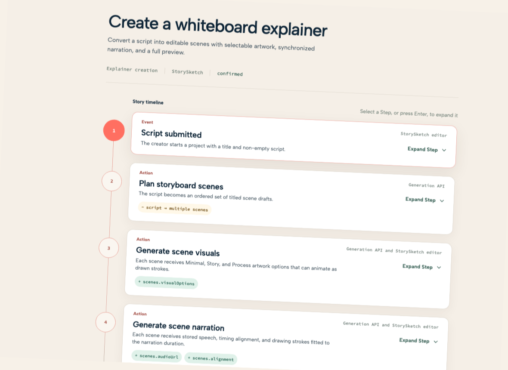
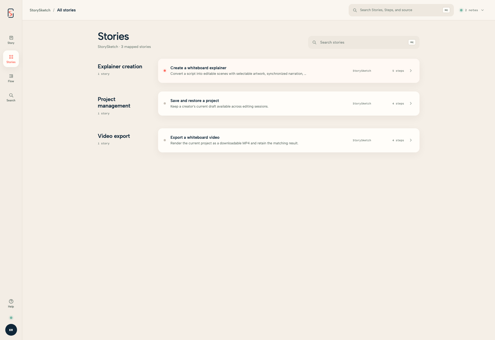
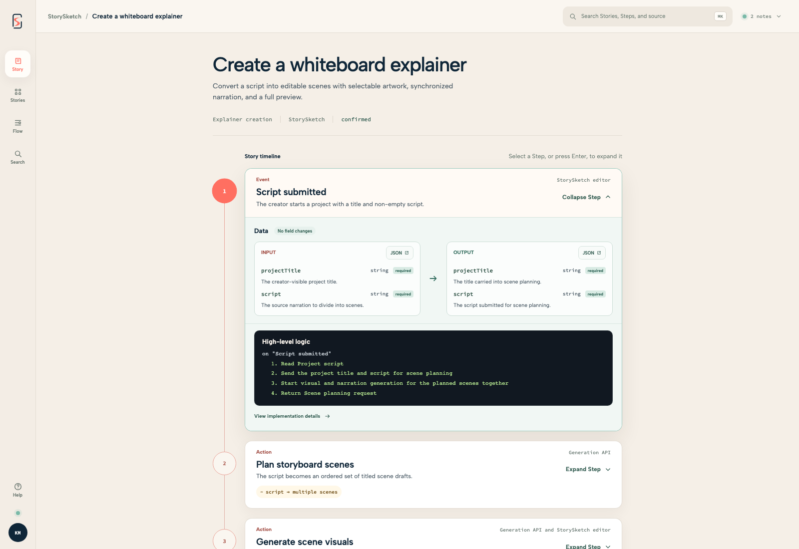
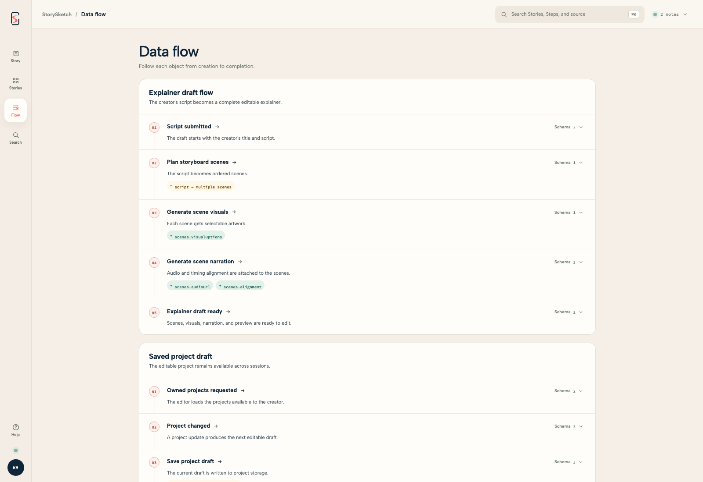
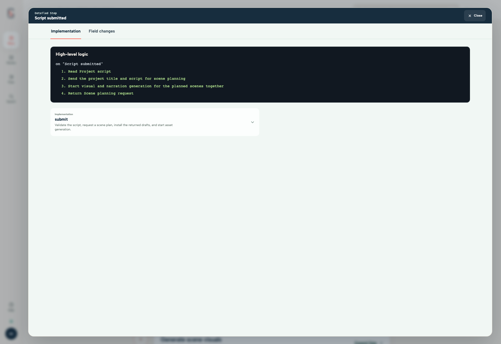
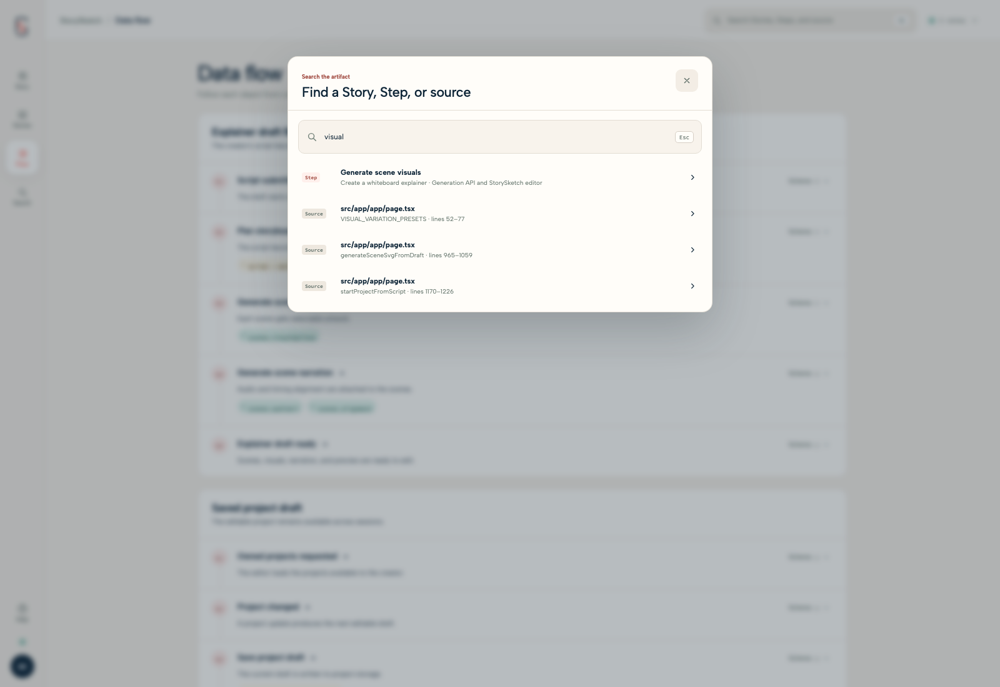
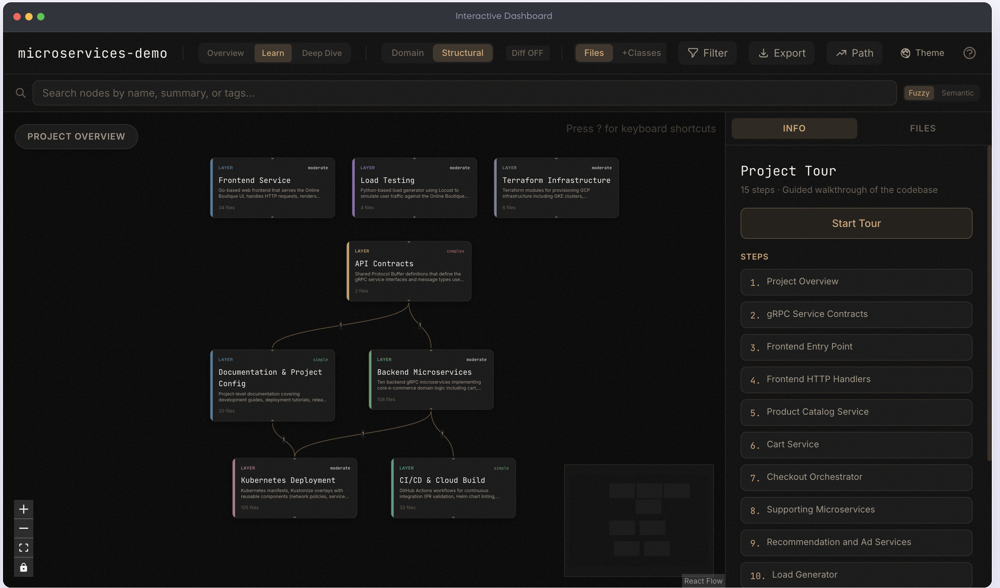

# Storyline

Storyline helps you understand an unfamiliar codebase by showing what the product does before showing how the code implements it. It turns source code into readable product stories that connect outcomes to Steps, data, systems, and source evidence.

Storyline answers **“What does this product do?”** before **“Which systems and files make it happen?”**

## Principles

Storyline is built around a few simple principles:

1. **Start with the outcome.** Begin with the user or system result, not with a file tree or a list of dependencies.
2. **Follow meaningful Steps.** Show the small sequence of actions, decisions, and results that make up a product flow.
3. **Reveal complexity progressively.** Keep the main flow readable, then expose data, systems, branches, and implementation details when they are useful.
4. **Preserve context.** Let you inspect one Step without losing sight of the Story it belongs to.
5. **Separate flow from dependency.** Use the Story to show progression. Show supporting relationships as context instead of implying that every connection is a causal step.
6. **Trace meaning to evidence.** Connect each semantic Step to the functions, files, services, APIs, and queries that support it.
7. **Be honest about uncertainty.** Distinguish evidence from interpretation and make unknowns visible.

## Core model

Storyline uses three levels:

1. **Story:** The complete product flow and intended outcome.
2. **Step:** One meaningful event, action, decision, or outcome within the Story.
3. **Implementation:** The code and systems that perform or support a Step.

A Story normally contains 3–7 meaningful Steps. Data structures, dependencies, and source details support the flow instead of replacing it.

## See it in action

The viewer lets you move from a product outcome to the supporting data and implementation evidence while keeping the original Story in view.

| Story view | Story catalog |
| --- | --- |
|  |  |
| **Story view.** Follow a product flow from its starting point to its outcome. | **Story catalog.** Browse Stories by product area and see their Steps and systems. |

| Step details | Data flow |
| --- | --- |
|  |  |
| **Step details.** Inspect inputs, outputs, field changes, and high-level logic for one Step. | **Data flow.** Trace named data objects across Steps and see how they change. |

| Implementation trace | Search |
| --- | --- |
|  |  |
| **Implementation trace.** Move from product behavior to the code and source evidence behind it. | **Search.** Find Stories, Steps, and source evidence from one keyboard-accessible search surface. |

## Comparison

Storyline and Understand Anything help people understand code in different ways. Understand Anything presents a broad graph of files, functions, classes, and dependencies. That kind of graph can be difficult to understand and navigate when many relationships appear at once.

Storyline starts with product behavior. It presents a focused Story first, then reveals the structural graph, data, and source evidence behind each Step as needed.

| Storyline | Understand Anything |
| --- | --- |
|  |  |
| **Behavior first.** Understand the product outcome and its meaningful Steps before exploring implementation detail. | **Structure first.** Explore a broad repository graph of connected code and systems. |

## Quick start

From the repository that you want to understand, ask an agent with the Storyline plugin installed:

```text
Use Storyline to create and open a visualization of this repository.
```

The `$storyline-create` skill initializes the workspace, analyzes the source, generates and validates the artifact, and opens the local viewer.

To open the checked-in Showcase artifact:

```bash
node plugins/storyline/scripts/storyline.mjs open-artifact showcase/storysketch/visualization.json
```

See [How Storyline Works](docs/how-storyline-works.md) for the full command flow, generated files, review process, and current limitations.

## Example

```text
Story: Confirm a completed payment

Payment completed
→ Prepare payment confirmation
→ Send payment confirmation
→ Confirmation sent
```

Expanding a Step reveals its Implementation:

```text
Prepare payment confirmation
├ collectPurchaseDetails()
├ formatConfirmation()
└ queueMessage()
```

Selecting a Step reveals its inputs, outputs, branches, external systems, and source location without hiding the Story.

For manual control, use the specialist skills:

```text
$storyline-understand
$storyline-generate
```

The [Storyline Guidelines](plugins/storyline/skills/storyline-generate/references/storyline-guidelines.md) explain how Stories are selected and shaped. The [Ubiquitous Language](docs/product/ubiquitous-language.md) defines the canonical product terms.

## Repository layout

```text
plugins/storyline/             Installable plugin, skills, CLI, bundled viewer, and tests
viewer/                        Editable React and Vite viewer source
showcase/                      Landing page and artifact-only examples
docs/                          Product, design, research, and planning documents
```

## Develop the viewer

Install the viewer dependencies, then start Vite:

```bash
pnpm --dir viewer install
pnpm --dir viewer dev
```

The development server serves the Showcase artifact at `/api/artifact`. Viewer state is stored in URL parameters so a Story, Step, context, or detail view can be shared.

After a viewer change, rebuild the plugin copy and run the tests:

```bash
pnpm --dir plugins/storyline install
pnpm --dir plugins/storyline build:viewer
pnpm --dir plugins/storyline test
```

Commit the viewer source and rebuilt plugin assets together. The build removes obsolete hashed assets.

## Project direction

Storyline is not a complete call graph, a data-model browser, or a replacement for source code. It keeps the product outcome primary and shows architecture as traceable evidence.

See the [product definition](docs/product/product.md), [active follow-up list](docs/planning/storyline-follow-up.md), and [design system](docs/design/design-system.md) for current direction.
